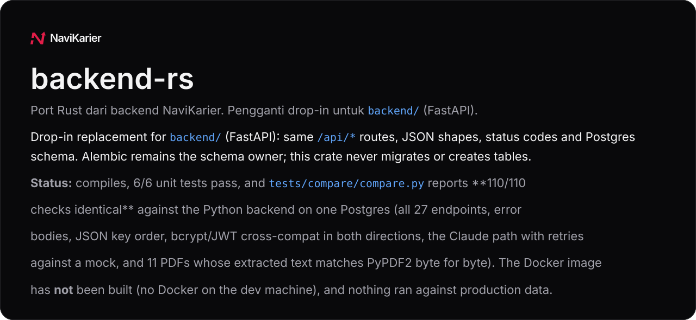
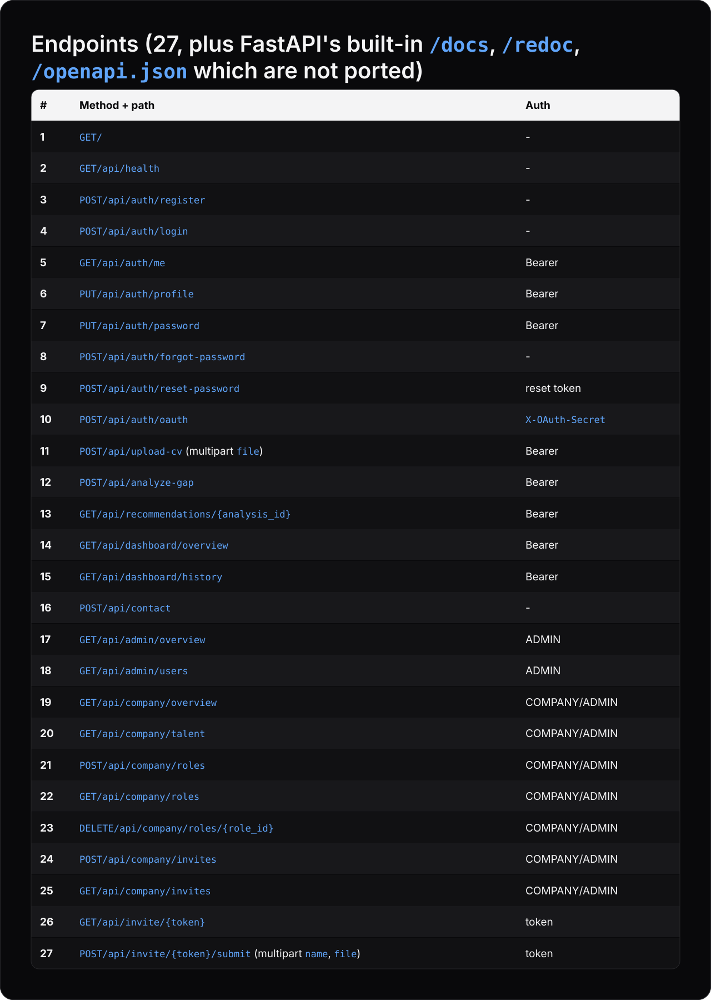
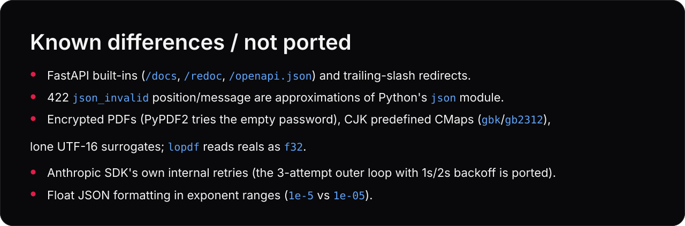

<!-- Generated by docs/render.py from docs/src/backend-rs-README.md. Edit the source, then run: python docs/render.py -->

<a id="backend-rs"></a>
<p align="center"></p>
<p align="center"><sub><a href="../README.md">Beranda repo</a> · <a href="../backend/README.md">Backend Python</a></sub></p>

<a id="endpoints-27-plus-fastapi-s-built-in-docs-redoc-openapi-json-which-are-not-ported"></a>
<p align="center"></p>

<a id="run"></a>
<p align="center"></p>

<a id="verify"></a>
<p align="center"></p>
<details><summary>Copy the commands</summary>

```powershell
cargo test                       # unit tests: bcrypt ($2b$ from Python), JWT, json.dumps, isoformat, fallback maths
cargo build --release
python backend-rs/tests/compare/compare.py   # Python vs Rust on one Postgres, every endpoint
```

</details>

<a id="pdf-extraction"></a>
<p align="center"></p>

<a id="known-differences-not-ported"></a>
<p align="center"></p>
