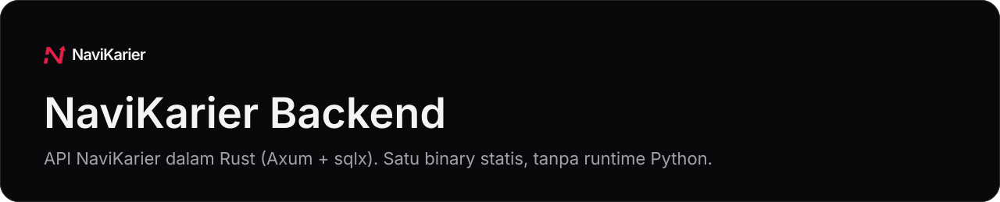
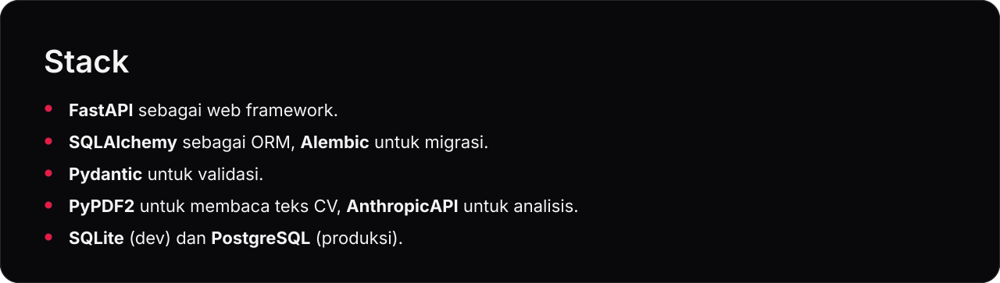
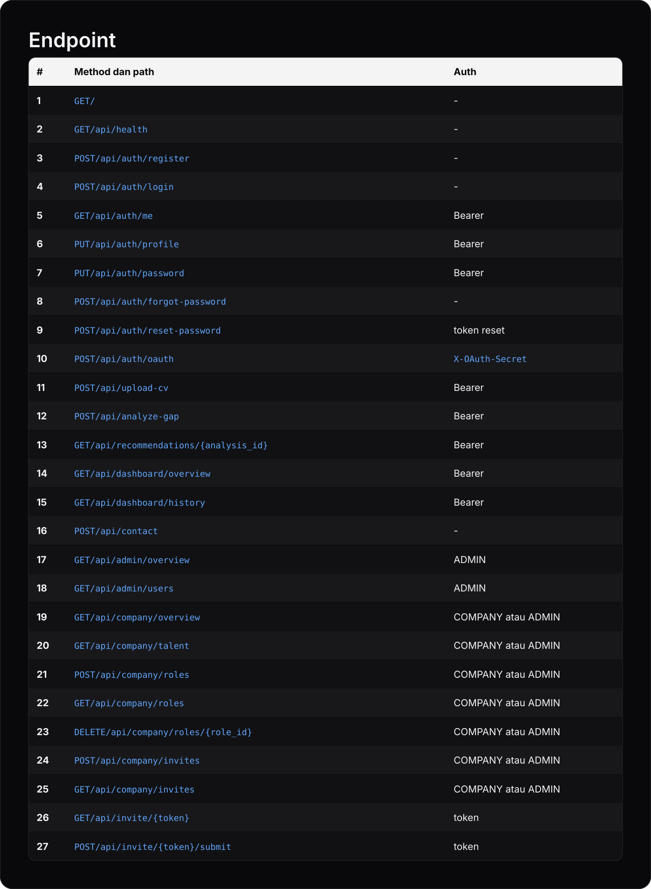

<!-- Generated by docs/render.py from docs/src/backend-README.md. Edit the source, then run: python docs/render.py -->

<a id="navikarier-backend"></a>
<p align="center"></p>
<p align="center"><sub><a href="../README.md">Beranda repo</a> · <a href="../backend-rs/README.md">Port Rust</a></sub></p>

<a id="stack"></a>
<p align="center"></p>

<a id="struktur"></a>
<p align="center"></p>
<details><summary>Copy the commands</summary>

```bash
backend/
├── app/
│   ├── main.py         entrypoint FastAPI (mount /api)
│   ├── database.py     engine SQLAlchemy dan Base
│   ├── models.py       model ORM
│   ├── schemas.py      skema Pydantic
│   ├── auth.py         utilitas JWT
│   ├── ai_service.py   integrasi AI
│   ├── services.py     logika bisnis dan analisis fallback
│   └── api/            router dan controller
├── alembic/            migrasi database
├── requirements.txt
└── .env.example
```

</details>

<a id="setup"></a>
<p align="center"></p>
<details><summary>Copy the commands</summary>

```bash
cd backend
python -m venv venv
source venv/bin/activate        # Windows: venv\Scripts\activate
pip install -r requirements.txt
cp .env.example .env            # Windows: copy .env.example .env
python -m alembic upgrade head
uvicorn app.main:app --reload --port 8000
```

</details>

<a id="api"></a>
<p align="center"></p>

<a id="produksi"></a>
<p align="center"></p>
