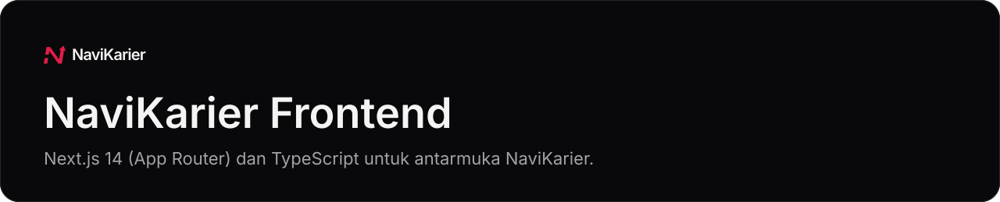
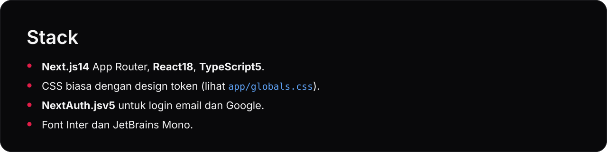
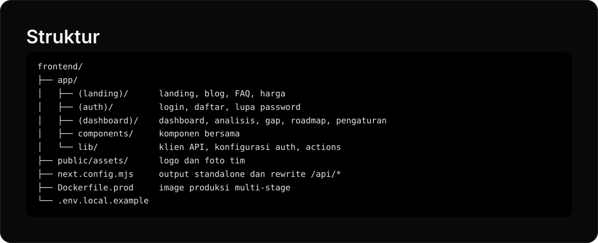
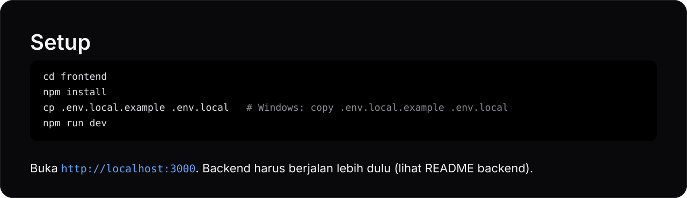
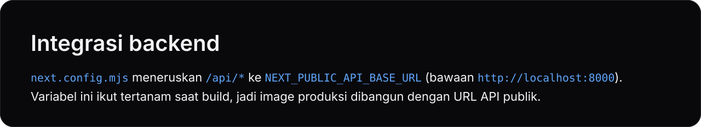
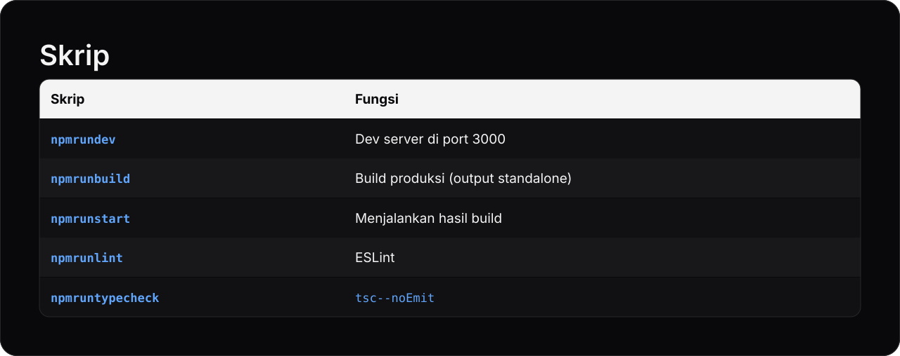
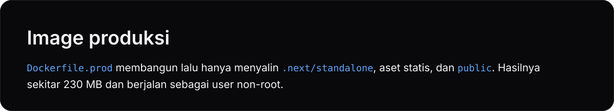

<!-- Generated by docs/render.py from docs/src/frontend-README.md. Edit the source, then run: python docs/render.py -->

<a id="navikarier-frontend"></a>
<p align="center"></p>
<p align="center"><sub><a href="../README.md">Beranda repo</a> · <a href="../backend/README.md">Backend</a></sub></p>

<a id="stack"></a>
<p align="center"></p>

<a id="struktur"></a>
<p align="center"></p>
<details><summary>Copy the commands</summary>

```bash
frontend/
├── app/
│   ├── (landing)/      landing, blog, FAQ, harga
│   ├── (auth)/         login, daftar, lupa password
│   ├── (dashboard)/    dashboard, analisis, gap, roadmap, pengaturan
│   ├── components/     komponen bersama
│   └── lib/            klien API, konfigurasi auth, actions
├── public/assets/      logo dan foto tim
├── next.config.mjs     output standalone dan rewrite /api/*
├── Dockerfile.prod     image produksi multi-stage
└── .env.local.example
```

</details>

<a id="setup"></a>
<p align="center"></p>
<details><summary>Copy the commands</summary>

```bash
cd frontend
npm install
cp .env.local.example .env.local   # Windows: copy .env.local.example .env.local
npm run dev
```

</details>

<a id="integrasi-backend"></a>
<p align="center"></p>

<a id="skrip"></a>
<p align="center"></p>

<a id="image-produksi"></a>
<p align="center"></p>
